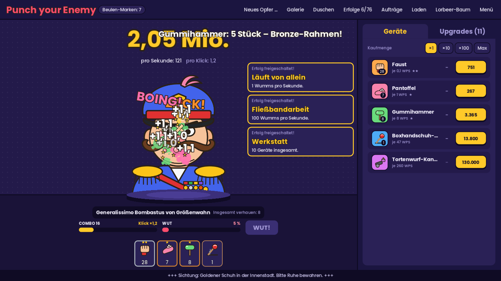
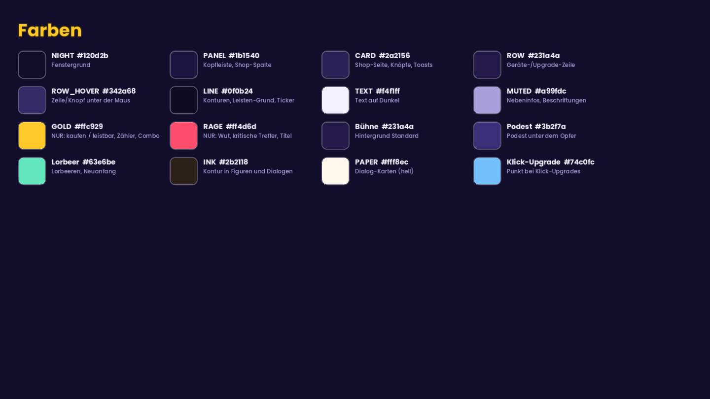
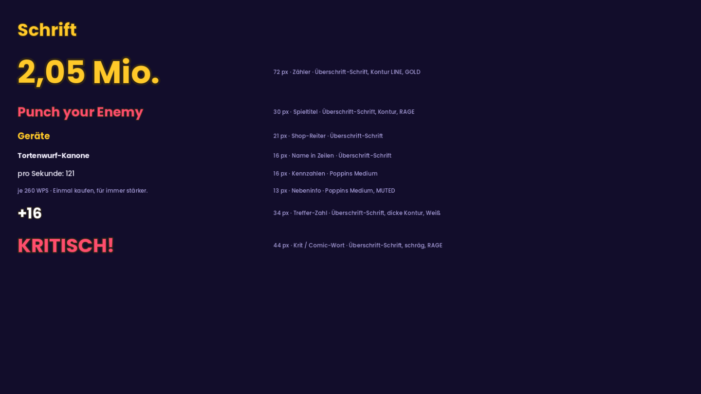
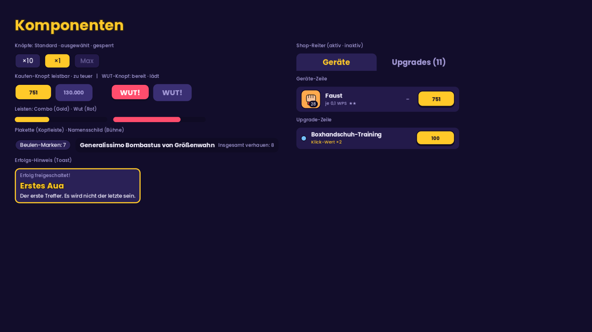
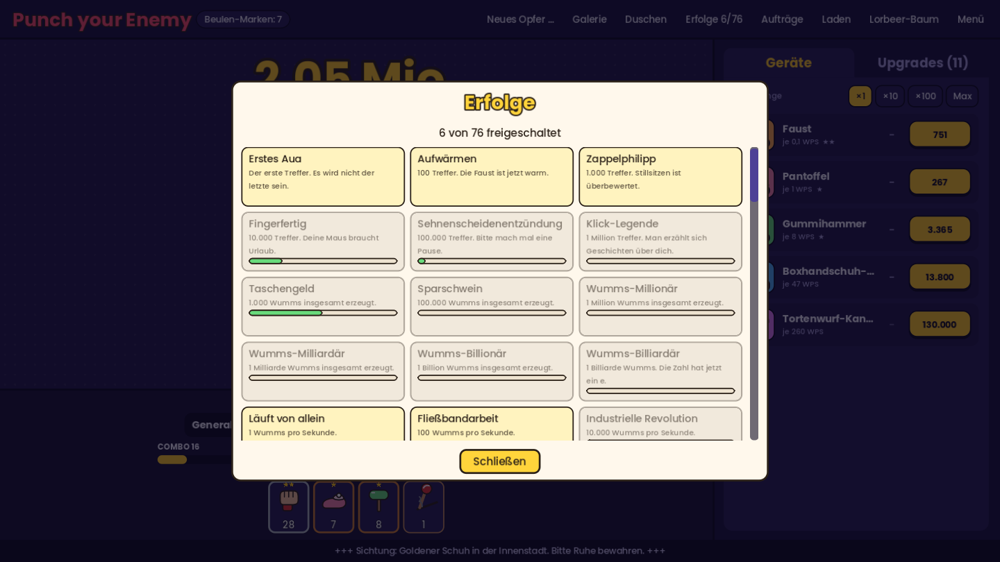
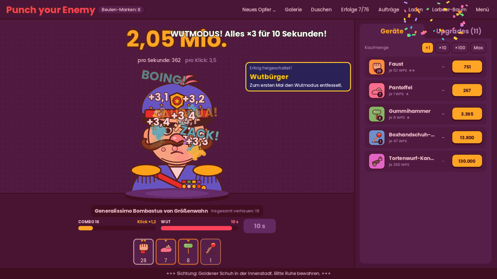
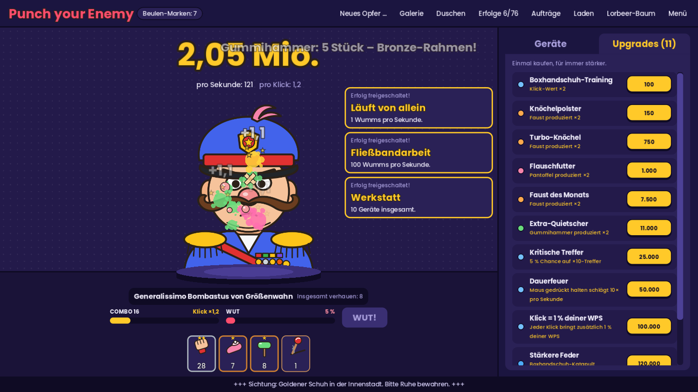

# Design-Vorlage: „Comic-Arena bei Nacht“

Diese Vorlage legt fest, wie **Punch your Enemy** aussieht. Jede neue Oberfläche, jedes neue Gerät und jede neue Figur
soll sich an diese Regeln halten, damit das Spiel aus einem Guss wirkt.

Alle Bilder in [`bilder/`](bilder/) stammen aus dem echten Spiel und werden mit einem Skript erzeugt (siehe
[Bilder neu erzeugen](#bilder-neu-erzeugen)). Bei Widersprüchen gilt der Code in `scripts/ui/main.gd`. Diese Datei
wird mit ihm zusammen aktualisiert.



---

## 1. Leitidee

- **Eine Bühne, ein Star.** Das Opfer steht im Scheinwerferlicht auf einem Podest in der Mitte. Alles andere ist
  Publikum: Es tritt zurück und lenkt nicht ab.
- **Nacht-Arena statt Formular.** Der Hauptbildschirm ist dunkel (Lila-Töne mit Rasterpunkten), damit das bunte Opfer, die
  Treffer-Effekte und die Kaufen-Knöpfe leuchten.
- **Farbe heißt etwas.** Gold bedeutet *kaufen / leistbar / dein Fortschritt*, Rot bedeutet *Wut / kritischer Treffer*.
  Andere Akzentfarben gibt es auf dem Hauptbildschirm nicht.
- **Comic-Slapstick.** Dicke Konturen, flache Farben, Sternchen, Beulen, Pflaster. Kein Blut, keine Realistik (siehe
  `AGENTS.md`, „Ton und Inhalt“).
- **Spürbares Feedback.** Jeder Treffer soll sich anfühlen: Squash, Ring, Zahl, Comic-Wort, bei Krits Wackeln.

## 2. Aufbau des Hauptbildschirms

```
┌───────────────────────────────────────────────────────────────────────────────┐
│ KOPFLEISTE  Titel · [Beulen-Marken]              Neues Opfer … Galerie … Menü  │  PANEL, Linie unten
├──────────────────────────────────────────────────────────┬────────────────────┤
│ Hinweise/Buffs (oben links)        2,05 Mio.             │ [Geräte][Upgrades] │
│                               pro Sekunde · pro Klick    │ ┌────────────────┐ │
│                                                          │ │ Kaufmenge ×1…  │ │
│                     ( O P F E R )      [Erfolgs-Toasts]  │ │ Geräte-Zeilen  │ │
│                    ════ Podest ════                      │ │ oder           │ │
│ ─────────────────── Bühnenkante ──────────────────────── │ │ Upgrade-Zeilen │ │
│               [ Name des Opfers · verhauen ]             │ │                │ │
│        COMBO ▬▬▬▬▬     WUT ▬▬▬▬▬     [ WUT! ]            │ └────────────────┘ │
│                 [Geräte-Reihe: Karten]                   │     SHOP (460 px)  │
├──────────────────────────────────────────────────────────┴────────────────────┤
│ TICKER  +++ Laufschrift +++                                                     │  LINE
└───────────────────────────────────────────────────────────────────────────────┘
```

| Bereich | Inhalt | Regel |
|---|---|---|
| Kopfleiste (`%TopBar`) | Titel, Beulen-Marken-Plakette, Navigation | Navigationsknöpfe sind **flach** (kein Rahmen, kein Hintergrund), nur Hover hebt sie hervor. |
| Bühne (`Stage`) | Zähler, Kennzahlen, Opfer, Namensschild, Leisten, Geräte-Reihe | Alles **zentriert**. Wichtiges (Zähler, Combo, WUT) ist groß und nah am Opfer. |
| Bühne oben links (`%StageInfo`) | Buffs, Lorbeeren, Neuanfang, Herausforderung, Tastenhilfe | Nur, was gerade relevant ist. Die Tastenhilfe sehen nur Neulinge (< 500 Treffer). |
| Shop (`%ShopPanel`) | Reiter **Geräte** / **Upgrades** | Feste Breite (460 px), damit die Bühne beim Reiterwechsel nicht springt. |
| Ticker (`%TickerBar`) | Witzige Laufschrift | Schmal, dunkel, nie aufdringlich. |

**Neue Elemente:** Erst fragen, ob es auf die Bühne gehört (direkt ums Hauen) oder in einen Dialog
(Verwaltung, Listen, Einstellungen). Im Zweifel → Dialog. Die Bühne bleibt aufgeräumt.

## 3. Farben



Farben auf dem Hauptbildschirm **nur über die Konstanten in `scripts/ui/main.gd`**, nie als neue Hex-Werte im Code.

| Konstante | Hex | Verwendung |
|---|---|---|
| `NIGHT` | `#120d2b` | Fenstergrund |
| `PANEL` | `#1b1540` | Kopfleiste, Shop-Spalte |
| `CARD` | `#2a2156` | Shop-Seite, Standard-Knöpfe, Toasts, Plaketten |
| `ROW` | `#231a4a` | Zeilen in Listen (Geräte, Upgrades) |
| `ROW_HOVER` | `#342a68` | Zeile/Knopf unter der Maus |
| `LINE` | `#0f0b24` | Konturen, Leisten-Grund, Namensschild, Ticker, Schrift auf Gold |
| `TEXT` | `#f4f1ff` | Text auf Dunkel |
| `MUTED` | `#a99fdc` | Nebeninfos, Beschriftungen, inaktive Reiter |
| `GOLD` / `GOLD_HOVER` | `#ffc929` / `#ffd95e` | **Nur:** Kaufen-Knöpfe (leistbar), ausgewählte Knöpfe, aktiver Reiter, Zähler, Combo |
| `RAGE` | `#ff4d6d` | **Nur:** Wut-Leiste, WUT-Knopf, kritische Treffer, Spieltitel |

Weitere feste Farben: Bühnenhintergrund `#231a4a` mit Rasterpunkten (Weiß, 6 % Deckkraft, alle 16 px), Bühnenboden
`#1a1338`, Podest `#3b2f7a`/`#4a3d94`, Lorbeeren/Neuanfang `#63e6be`. Geräte haben ihre eigene Farbe in
`data/devices.json` (`color`), die für ihre Symbol-Kachel und ihren Upgrade-Punkt verwendet wird.

**Regeln**
- Gold und Rot **nie** für Deko. Wenn alles leuchtet, leuchtet nichts.
- Text auf Gold ist immer `LINE` (dunkel), Text auf Rot immer Weiß.
- Gesperrtes/zu Teures ist **nicht ausgegraut-hell**, sondern tritt dunkel zurück (`#3a2f73`, Schrift `MUTED`).
- Kontrast: Fließtext mindestens 4,5 : 1 gegen seinen Grund (`TEXT` und `MUTED` auf `CARD`/`ROW` erfüllen das).

## 4. Schrift



- **Fließtext:** Poppins Medium (`assets/fonts/Poppins-Medium.ttf`), Standardgröße 17 px.
- **Überschriften, Zahlen, Namen:** `main.gd.heading_font()`. Das ist Poppins Bold, oder eine echte Comic-Schrift, sobald sie als
  `assets/fonts/heading.ttf` vorliegt (Wunsch: Lilita One oder Bangers, beide OFL). Die Vorlage gilt für beide.
- **Große Zahlen und Comic-Wörter** bekommen eine Kontur über `_comic(label, größe, farbe)` (Kontur `INK`, Stärke ≥ ¼ der Schriftgröße bei Popups).

| Größe | Wofür | Schrift |
|---|---|---|
| 72 px | Wumms-Zähler | Überschrift + Kontur, `GOLD` |
| 30 px | Spieltitel | Überschrift + Kontur, `RAGE` |
| 21 px | Shop-Reiter | Überschrift |
| 16 px | Namen in Zeilen, Namensschild, Kennzahlen | Überschrift bzw. Medium |
| 13–14 px | Leisten-Beschriftung, Buffs, Hinweise | Medium |
| 12 px | Nebeninfo in Zeilen | Medium, `MUTED` |
| 34–64 px | Treffer-Zahlen, „KRITISCH!“, Comic-Wörter | Überschrift + dicke Kontur |

Zahlen immer über `Num.fmt()` / `Num.whole()`, Texte immer über `tr()` (siehe `AGENTS.md`).

## 5. Komponenten



Alle Kästen entstehen mit `_box(farbe, radius, rahmen, innenabstand, rahmenfarbe)`, einem `StyleBoxFlat`.

| Komponente | Aussehen | Code |
|---|---|---|
| **Standard-Knopf** | `CARD`, Rahmen 2 px `LINE`, Radius 10. Ausgewählt (Toggle) → `GOLD` mit dunkler Schrift. Gesperrt → `ROW`, Schrift `MUTED` | Theme in `_build_theme()` |
| **Kaufen-Knopf** | `GOLD`, Rahmen 2 px `LINE`, **unten 5 px** (wirkt gedrückt-bereit), Radius 12, Überschrift-Schrift. Zu teuer → `#3a2f73` ohne Rahmen | `_style_buy_button(knopf, größe)` |
| **WUT-Knopf** | wie Kaufen-Knopf, aber `RAGE` mit weißer Schrift, 104 × 46 px | `_build_stats_extras()` |
| **Navigations-Knopf** | flach, transparent, 15 px. Hover → `ROW_HOVER` | `_style_panels()` |
| **Shop-Reiter** | aktiv: `CARD`, oben gerundet, Schrift `GOLD`, verschmilzt mit der Seite darunter. Inaktiv: transparent, `MUTED` | `_style_panels()` |
| **Listen-Zeile** | `ROW`, Radius 12, kein Rahmen, Hover → `ROW_HOVER`. Links Symbol/Punkt, Mitte Name + Info, rechts Kaufen-Knopf | `_build_device_rows()`, `_rebuild_upgrades()` |
| **Symbol-Kachel** | 52 × 52, Gerätefarbe, Rahmen 2 px `LINE`, Radius 12. Stückzahl als dunkle Plakette unten rechts | `_build_device_rows()` |
| **Leiste** | 14 px hoch, Grund `LINE`, Füllung rund (Radius 7), ohne Rahmen. Beschriftung darüber: links Name, rechts Wert | `_bar(farbe)` |
| **Plakette** | `CARD`, voll gerundet (Radius 20), Rahmen 2 px `LINE` | `%MarkenChip` |
| **Namensschild** | `LINE`, Radius 12, Name in Überschrift-Schrift + Info in `MUTED` | `%NamePlate` |
| **Toast (Erfolg/Buff)** | `CARD`, Rahmen 2–3 px `GOLD` (schlechter Buff: `RAGE`) | `_on_achievement_unlocked()`, `_refresh_buffs()` |

**Shop-Listen:** Upgrades zeigen immer ihre **Wirkung** sichtbar (`GameState.upgrade_effect_text()`). Die
Beschreibung steht im Tooltip. Der Upgrade-Punkt hat die Farbe nach Art: Gerät → Gerätefarbe, Klick → `#74c0fc`,
global → `GOLD`.

## 6. Dialoge



Dialoge (`Modal.open()`) und Mini-Spiele sind **helle Karten über der abgedunkelten Bühne**. Sie nutzen
`main.gd.paper_theme()`: Papier `#fff8ec`, Kontur `INK #2b2118` (3 px), gelbe Knöpfe, Titel in Gelb mit Kontur.
So heben sie sich klar vom Spiel ab.

- Neue Dialoge **immer** über `Modal.open()`, nie über Godots eigene Dialoge.
- Innerhalb von Dialogen gelten die hellen Farben (Kacheln `#fff3bf` / `#fffdf7`, Schrift `INK`).
- Ein Dialog hat einen Titel, einen Inhalt und 1–3 Knöpfe. Der wichtigste Knopf steht links.

## 7. Bühne, Opfer und Effekte



- **Podest:** Das Opfer steht auf einer Ellipse (`target_area.gd`, `_draw_podium()`), die den unteren Bildrand verdeckt.
  Die Bühnenkante im Hintergrund folgt dem Podest automatisch (`_sync_stage_floor()`).
- **Treffer:** weißer Aufprall-Ring, Farbspritzer, Sternchen, Zahl „+X“ (34 px, Weiß), mit 35 % Wahrscheinlichkeit ein
  Comic-Wort. Krit: „KRITISCH!“ in `RAGE` (64 px), Bildschirm wackelt.
- **Squash:** Das Opfer staucht bei jedem Treffer kurz zusammen und federt zurück (elastisch, 0,25 s).
- **Wutmodus:** Der ganze Bildschirm pulsiert rot getönt, die WUT-Leiste zählt die Sekunden herunter.
- **Barrierefreiheit:** Alle Bewegungs-Effekte respektieren `GameState.reduced_effects`. Neue Effekte auch.

## 8. Figuren und Symbole

| | Regel |
|---|---|
| **Figuren** (`assets/figures/`) | SVG, 560 × 640, Kontur `#2b2118` 7 px, runde Ecken/Enden, flache Farben, große Augen, übertriebene Merkmale. **Frei erfunden**, keine Ähnlichkeit mit realen Personen oder echten Hoheitszeichen. Drei Mimik-Stufen: normal, `_genervt`, `_am_ende`. Die Figur füllt das Bild bis zum unteren Rand (das Podest verdeckt die Schnittkante). |
| **Geräte-Symbole** (`assets/devices/`) | SVG, 64 × 64, Kontur `#2b2118` 3 px, flach, gut lesbar auf ihrer Gerätefarbe. |
| **Faust-Skins** (`assets/cursor/`) | Paar `fist_open_<name>.svg` / `fist_hit_<name>.svg`, gleicher Stil wie die Geräte-Symbole. |
| **UI-Symbole** | Keine Emojis. Sternchen ★ nur für Meilensteine. |

Beispiele: [Bombastus](../../assets/figures/bombastus.svg) · [genervt](../../assets/figures/bombastus_genervt.svg) ·
[Pantoffel](../../assets/devices/pantoffel.svg) · [Goldener Schuh](../../assets/events/golden_shoe.svg)

## 9. Machen / Lassen

| ✅ Machen | ❌ Lassen |
|---|---|
| Farben über die Konstanten in `main.gd` | Neue Hex-Farben direkt im Code verstreuen |
| Gold nur für „kaufen / leistbar“ | Gold oder Rot als Deko |
| Zentrale Infos nah ans Opfer | Wichtige Werte klein an den Rand |
| Wirkung sichtbar, Erklärtext im Tooltip | Lange Texte in Knöpfen und Zeilen |
| Feste Breiten für Spalten, Text kürzen mit „…“ | Spalten, die mit dem Inhalt wachsen und die Bühne verschieben |
| Verwaltung und Listen in Dialoge | Neue Dauer-Panels auf der Bühne |
| Effekte mit `reduced_effects`-Schalter | Effekte, die sich nicht abschalten lassen |

## 10. Checkliste für neue Oberflächen

1. Gehört es auf die Bühne oder in einen Dialog?
2. Nur Paletten-Konstanten verwendet? Gold/Rot nur mit ihrer Bedeutung?
3. Knöpfe über Theme oder `_style_buy_button()`, Kästen über `_box()`?
4. Schriftgrößen aus der Tabelle in Abschnitt 4?
5. Alle Texte in `tr()` und in `locale/en.po` übersetzt (`python3 tools/i18n.py --check`)?
6. Funktioniert es mit „Weniger Effekte“?
7. Bilder dieser Vorlage neu erzeugt, wenn sich das Aussehen geändert hat?

## Bilder neu erzeugen

Die Bilder entstehen aus dem echten Spiel. Der Spielstand wird dabei nicht verändert:

```bash
godot --path . --script res://tools/design_shots.gd
```

Nicht `--headless`, denn es wird gerendert. Das Skript legt die Bilder in `docs/design/bilder/` ab:

| Bild | Inhalt |
|---|---|
| `01_hauptbildschirm.png` | Hauptbildschirm mit Geräte-Reiter und Treffer-Effekten |
| `02_shop_upgrades.png` | Upgrade-Reiter |
| `03_wutmodus.png` | Wutmodus aktiv |
| `04_dialog.png` | Heller Dialog (Erfolge) |
| `05_farben.png` | Farbtafel |
| `06_komponenten.png` | Knöpfe, Leisten, Zeilen, Plaketten, Toast |
| `07_schrift.png` | Schriftgrößen |

Der Ordner hat eine `.gdignore`, damit Godot die Bilder nicht ins Spiel importiert.


